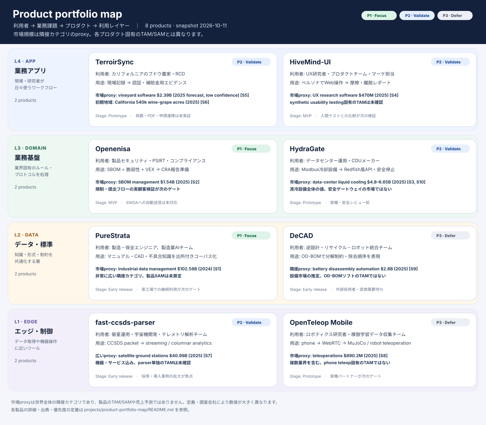
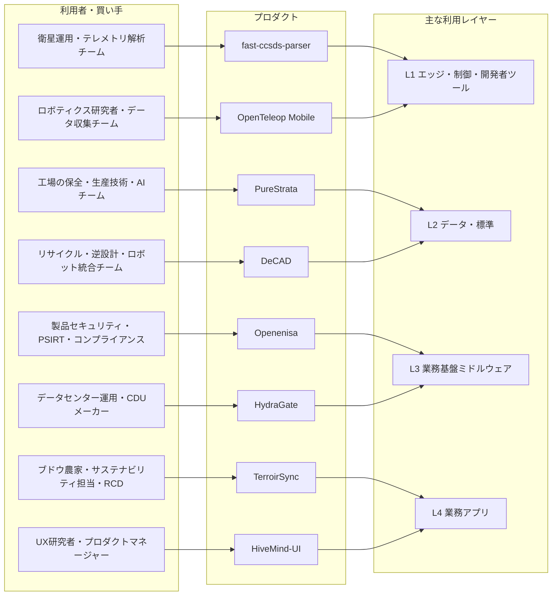

# Product portfolio map

**Snapshot: 2026-10-11.** This map places the eight products by target user, use case, and technical layer. It is a portfolio view, not a claim that the products share one technical stack.

## User → product → layer

## Product and market overview

| Product | Primary users and job | Layer | Market-size proxy (not product TAM) | Stage | Priority |
| --- | --- | --- | --- | --- | --- |
| **PureStrata** | Manufacturing, maintenance, and AI teams; structure manuals, CAD, and failure knowledge with provenance | Data / knowledge | Industrial data management: **US$102.58B (2024)**, a much broader category [S1] | Early release | P1 |
| **Openenisa** | Product security, PSIRT, and compliance teams; prepare SBOM-driven vulnerability and CRA reports | Domain middleware | SBOM management: **US$1.54B (2025)** [S2] | MVP | P1 |
| **HydraGate** | Data-center operators and CDU vendors; bridge cooling telemetry and safe leak response | Domain middleware | Data-center liquid cooling: **US$4.8B (2025)**; cooling systems, not gateway software [S3] | Prototype | P2 |
| **HiveMind-UI** | UX researchers and product teams; test interfaces with simulated personas and review behavior | Workflow application | UX research software: **US$470.3M (2025)** [S4] | MVP | P2 |
| **TerroirSync** | California vineyard growers, sustainability leads, and RCDs; turn field records into compliance/grant evidence | Workflow application | Vineyard software report: **US$2.39B (2025 forecast)**, low confidence and broad [S5]. California reported **540,000 wine-grape acres for 2025** [S6] | Prototype | P2 |
| **fast-ccsds-parser** | Spacecraft and mission teams; parse CCSDS packets into streaming/columnar data | Developer library / edge data | Satellite ground stations: **US$40.99B (2025)**, including hardware/services; no separate parser TAM found [S7] | Early release | P2 |
| **OpenTeleop Mobile** | Robotics labs and data-collection teams; teleoperate a simulated/real arm from a phone | Robot control | Teleoperations: **US$890.2M (2025)**, a broad cross-industry category [S8] | Prototype | P3 |
| **DeCAD** | Reverse-engineering, recycling, and robotics teams; represent product disassembly constraints in OD-BOM | Data standard / planning input | No defensible direct TAM found. Battery-disassembly automation is an adjacent equipment market, not DeCAD software [S9] | Early release | P3 |

HydraGate's liquid-cooling estimate is one vendor-research estimate; another source puts the same broad category at **US$6.65B for 2025**. Treat the difference as a reminder that category definitions vary [S3, S10].

## Reading the market figures

- These are **global adjacent-category estimates**, not revenue available to each product. The product-specific TAM/SAM is not established.
- The figures come from commercial market-research providers and are not directly comparable. Some markets include hardware, services, or much broader software categories.
- Vineyard software's cited 2025 value is from a report published in 2021. It is stale, broad, and especially low-confidence; the California acreage figure is a regional footprint indicator, not software spend.
- No standalone market size was found for CCSDS packet parsers or OD-BOM disassembly data. The adjacent categories are context only, not evidence of those products' addressable revenue.
- The next sizing step should be bottom-up: **reachable buyers × realistic annual contract value × adoption rate**, using customer interviews and pilot data.

## Priority logic

- **P1 — Focus now:** move toward a customer pilot or real-data validation in the next cycle.
- **P2 — Validate:** test one key business assumption cheaply before expanding scope.
- **P3 — Defer:** maintain the product and defer major investment until an adopter, partner, or hardware path is proven. P3 does not mean cancel.

Priority is a working hypothesis based on the current implementation, unresolved dependencies, and the market proxies above. It is not a market-sizing study or a forecast.

## Sources

1. [Grand View Research, Industrial Data Management Market](https://www.grandviewresearch.com/industry-analysis/industrial-data-management-market), 2024 estimate.
2. [Growth Market Reports, SBOM Management Market](https://growthmarketreports.com/report/sbom-management-market), 2025 estimate.
3. [Global Market Insights, Data Center Liquid Cooling Market](https://www.gminsights.com/industry-analysis/data-center-liquid-cooling-market), 2025 estimate.
4. Fortune Business Insights, *User Experience (UX) Research Software Market Size, 2034*, 2025 baseline (US$470.3M).
5. [Data Bridge Market Research, Vineyard Management Software Market](https://www.databridgemarketresearch.com/reports/global-vineyard-management-software-market), 2021 report forecasting 2025.
6. [Wine Business, 2025 California wine-grape acreage](https://www.winebusiness.com/news/article/316967), citing the CDFA report; see also [California Association of Winegrape Growers acreage survey](https://cawg.org/industry-resources/acreage-report/).
7. [MarketsandMarkets, Satellite Ground Station Market](https://www.marketsandmarkets.com/PressReleases/satellite-ground-station.asp), 2025 estimate.
8. Persistence Market Research, *Teleoperations Market Size, Share & Growth Analysis, 2032*, 2025 baseline (US$890.2M).
9. [DataIntelo, Battery Disassembly Automation Market](https://dataintelo.com/report/battery-disassembly-automation-market), 2025 estimate; adjacent equipment market.
10. Grand View Research, [Data Center Liquid Cooling Market](https://www.grandviewresearch.com/industry-analysis/data-center-liquid-cooling-market), 2025 estimate.

Sources accessed 2026-10-11.
